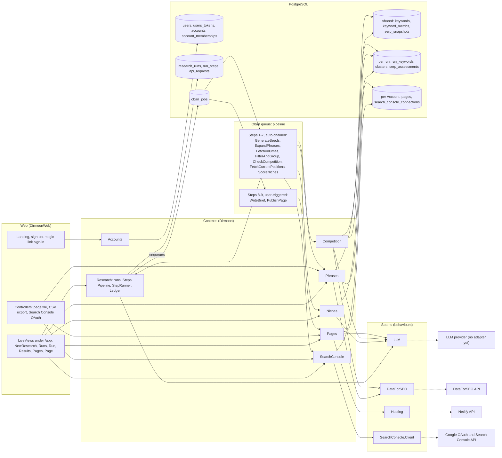

# Architecture

How dirmoon is built today. Planned work lives in `docs/design/README.md` (the product spec), `.claude/work/` plans and `docs/adr/`, not here. Terms in capitals are defined in `CONTEXT.md`.

## Overview

A signed-in User describes a business; a Research Run takes it through nine Steps, each an Oban job that calls one context and stores its output. Steps 1–7 run on their own and end with scored Niches. The User then picks a Niche (Step 8 writes a Brief and a Produced Page) and publishes or downloads the page (Step 9). LiveView screens follow a run over PubSub. Four external services sit behind behaviours: an LLM, DataForSEO, Google Search Console and Netlify.

## Stack

- Elixir ~> 1.17, Phoenix 1.8, Phoenix LiveView 1.2, Bandit
- Ecto with PostgreSQL (`Dirmoon.Repo`); the `citext` extension for `users.email`
- Oban (`Oban.Engines.Basic`, one queue `pipeline` with 5 workers, `Oban.Plugins.Pruner`)
- Phoenix.PubSub (`Dirmoon.PubSub`) for run and page updates
- Req for every HTTP client; Swoosh for email
- Tailwind v4 and esbuild; design tokens in `assets/css/tokens.css`, fonts in `assets/css/fonts.css`; no daisyUI
- Gettext with default locale `pl` (Ecto error messages); screen copy is Polish, written in the templates
- Tests: ExUnit, Mox, ExMachina, `Req.Test`, LazyHTML
- Styler, Credo (`--strict`) and ex_slop, all run by `mix precommit`

## Contexts

All under `lib/dirmoon/`. Functions that take an id from params take the `Scope` first and filter by `scope.account`; functions called from a Step take a `%Run{}` (or a struct) already resolved upstream.

| Context | Owns | Key public entry points | Calls |
|---|---|---|---|
| `Accounts` | `User` (`users`), `UserToken` (`users_tokens`), `Account` (`accounts`), `Membership` (`account_memberships`), `Scope`, `UserNotifier` | `sign_up/2`, `register_user/1`, `scope_for_user/1`, `login_user_by_magic_link/1`, `deliver_login_instructions/2`, session-token and email-change functions | `Mailer` |
| `Research` | `Run` (`research_runs`), `RunStep` (`run_steps`), `ApiRequest` (`api_requests`); `Steps`, `Pipeline`, `StepRunner`, `Ledger`, `Seeds` (Step 1), `StatusLine`, `RunsStatusLine` | `start_run/2`, `get_run/2`, `list_runs/1`, `stop_run/2`, `resume_run/2`, `run_cost/1`, `run_costs/1`, `estimated_cost/1`, `running?/1`, `idle?/1`, `lock_run!/1`, `step_output/2`, `subscribe/1`, `broadcast_progress/2`, `broadcast_run_updated/1`; `Run.results_ready?/1`, `Run.choosable?/1` | `Accounts` (Scope), `LLM` |
| `Phrases` | `Phrase` (`keywords`), `Volume` (`keyword_metrics`), `RunPhrase` (`run_keywords`); `Expansion` (Step 2), `Volumes` (Step 3), `LedgerRows` | `store_expansion/2`, `store_volumes/2`, `phrases_needing_volume/2`, `list_for_run/2`, `count_by_status/1`, `export_rows/1`, `top_kept_in_niches/2`, `market_totals_by_niche/1`, `clear_grouping/1`, `assign_to_niche/2`, `reject/2`, `reject_ungrouped/2`, `store_current_positions/2`, `quick_win_range/0` | `Research` (Ledger, `step_output/2`, `put_city_location/2`), `DataForSEO`, `Competition` (readings for the export) |
| `Niches` | `Niche` (`clusters`); `Grouping` (Step 4), `Scoring` (pure), `ScoreStep` (Step 7) | `store_groups/2`, `list_for_run/1`, `list_summaries/1`, `niche_detail/2`, `niche_aggregates/1`, `store_scores/2`, `get_niche/2`, `choose/2`, `reject/2`; `Scoring.worth?/1`, `Niche.choosable?/1` | `Research` (Ledger, `lock_run!/1`, `idle?/1`, `Pipeline.start_step/2`), `Phrases`, `Competition`, `Pages`, `LLM` |
| `Competition` | `SerpSnapshot` (`serp_snapshots`), `SerpAssessment` (`serp_assessments`); `Check` (Step 5) | `fresh_snapshot/2`, `store_snapshot/1`, `store_assessment/2`, `assessments_for_run/1`, `readings_for_run/1`, `verdict/1`, `holders/1`, `weak_share/1`, `direct_competitor_count/1`, `checked_line/2` | `Research` (Ledger, `running?/1`, `broadcast_progress/2`), `Phrases`, `DataForSEO`, `LLM` |
| `SearchConsole` | `Connection` (`search_console_connections`); `Client` (seam), `Positions` (Step 6) | `authorize_url/2`, `connect/2`, `get_connection/1`, `connected?/1`, `disconnect/1`, `connection_for_run/1`, `refresh_token/1` | `SearchConsole.Client`, `Phrases` (`store_current_positions/2`) |
| `Pages` | `Page` (`pages`) with the embedded `Brief`; `BriefWriter` (Step 8), `Publisher` (Step 9), `Template` + `template.css`, `Placeholders`, `StatusLine` | `get_page/2`, `list_pages/1`, `change_brief/2`, `update_brief/3`, `publish/2`, `content_file/2`, `render/1`, `subscribe/1`; pipeline-internal: `create_for_niche/2`, `restart_writing/1`, `store_brief/2`, `store_hosting_site/2`, `store_published/2`, `fail_writing_pages/2`, `fail_publishing_pages/2` | `Research` (Ledger, `lock_run!/1`, `idle?/1`, `Pipeline.start_step/2`), `Phrases`, `LLM`, `Hosting` |

Seam modules and helpers at the same level:

| Module | What it is |
|---|---|
| `Dirmoon.LLM`, `Dirmoon.DataForSEO`, `Dirmoon.Hosting`, `Dirmoon.SearchConsole.Client` | Behaviour plus dispatch to the adapter in app config (see External services) |
| `Dirmoon.Polish` | Polish plurals and number, decimal and money formatting (`plural/2`, `usd/1`, `money/2`, `integer/1`, `feminine_number/1`) |
| `Dirmoon.demo_data?/0` | Whether Demo Data is on (`config :dirmoon, :demo_data`) |
| `Dirmoon.Workers.*` | The nine Oban workers (see Background work) |

Schemas reference each other across contexts (`RunPhrase` belongs to a `Niche`, `Page` belongs to a `Niche` and a `Run`, the SERP schemas belong to a `Phrase`); queries on another context's table go through that context's functions.

## Web

`lib/dirmoon_web/router.ex`. Everything is server-rendered HTML; the `:api` pipeline is defined but mounts no route.

| Scope | Pipelines | Serves |
|---|---|---|
| `/` | `:browser` | Landing page (`PageController.home/2`), `POST /sign-up` (`SignUpController.create/2`) |
| `/users/log-in`, `/users/log-in/:token`, `POST /users/log-in`, `DELETE /users/log-out` | `:browser`; `live_session :current_user` | Magic-link sign-in: `UserLive.Login`, `UserLive.Confirmation`, `UserSessionController` |
| `/users/settings`, `/users/settings/confirm-email/:token` | `:browser`, `:require_authenticated_user`; `live_session :require_authenticated_user` | `UserLive.Settings` (change email) |
| `/app` | `:browser`, `:require_authenticated_user`; LiveViews in `live_session :app` | The signed-in app (tables below) |
| `/dev` (dev only) | `:browser` | LiveDashboard, Swoosh mailbox |

**Auth and the Scope.** `DirmoonWeb.UserAuth` is phx.gen.auth's magic-link flow: no passwords. `:browser` runs `fetch_current_scope_for_user`, which assigns `current_scope` (`%Accounts.Scope{user:, account:}`, the Account of the User's first Membership) from the session token or the remember-me cookie. `:require_authenticated_user` (plug) and `on_mount {UserAuth, :require_authenticated}` (LiveViews) redirect a guest to `/users/log-in`. Sign-in lands on `/app`. Every context call from a screen or controller passes `current_scope`; a foreign or malformed id reads as "not found". Sign-up answers the same for a new and a registered email.

Screens (all `Layouts.app`, which shows the "DANE TESTOWE" banner when Demo Data is on):

| Route | Module | What it does |
|---|---|---|
| `GET /app` | `AppController.index/2` | Redirects to `/app/research/new` |
| `/app/research/new` | `NewResearchLive` | The run form (description, Mode, country, city, domain, Priority Services), estimated API Cost, Search Console connect link; `Research.start_run/2` |
| `/app/runs` | `RunsLive` | The newest 50 runs with status and API Cost; not live |
| `/app/runs/:id` | `RunLive` | Live Step list, Step 5 progress, stop and resume, API Cost; navigates to the results when Step 7 finishes |
| `/app/runs/:id/results` | `ResultsLive` | Views `niches`, `phrases`, `rejected` (`?view=`, `?niche=`); Niche detail; choose and reject a Niche. Phrase views show at most 500 rows |
| `/app/pages` | `PagesLive` | The newest 50 pages |
| `/app/pages/:id` | `PageLive` | Brief form with a live preview (`iframe srcdoc`), save, publish, download link, retry a failed Brief |

Controllers in the `/app` scope, outside the live session:

| Route | Module | What it does |
|---|---|---|
| `GET /app/pages/:id/file` | `PageFileController.show/2` | Downloads the Content File (`Pages.content_file/2`) as `<slug>.html`; 404 when not found or no Brief yet |
| `GET /app/runs/:id/export.csv` | `RunExportController.show/2` | Every Phrase of the run, kept and rejected (`Phrases.export_rows/1`), as `research-<id>.csv`: UTF-8 with BOM, CRLF, formula cells prefixed with `'` |
| `GET /app/search-console/connect` | `SearchConsoleController.connect/2` | Puts a random `state` and a checked `return_to` (only `/app…` paths) in the session, redirects to Google |
| `GET /app/search-console/callback` | `SearchConsoleController.callback/2` | Accepts only the `state` issued to this session (single use), exchanges the code, stores the Connection |
| `DELETE /app/search-console` | `SearchConsoleController.delete/2` | Removes the Connection (does not revoke at Google) |

Shared web modules: `DirmoonWeb.UI` (buttons, wordmark, prompt box, "how it works" panel, stopped-run note), `RunDisplay` and `PageDisplay` (labels and paths), `ResultsHeadline`.

## Background work

One Oban queue, `pipeline`. Each worker is `use Oban.Worker, queue: :pipeline, max_attempts: 3` with args `%{run_id: id}` and a `perform/1` that hands the Step's function to `Research.StepRunner.run/3`. `Research.Steps` is the one list of Steps (number, key, name, worker, Modes).

| Step | Worker | Triggered by | Calls | Writes |
|---|---|---|---|---|
| 1 Seeds | `GenerateSeeds` | `Research.start_run/2` | `Research.Seeds.generate/1` (LLM) | Step output: 10–20 Seeds and customer questions |
| 2 Expansion | `ExpandPhrases` | Step 1 done | `Phrases.Expansion.expand/1` (DataForSEO keyword ideas, 20 Seeds per request) | `keywords`, `keyword_metrics` (country), `run_keywords` |
| 3 Volumes | `FetchVolumes` | Step 2 done | `Phrases.Volumes.fetch/1` (DataForSEO location lookup and search volumes, 1000 Phrases per request) | `research_runs.city_location_code`, `keyword_metrics` for the country and the city, only for Phrases with no Volume fetched in the last 30 days |
| 4 Filter and Group | `FilterAndGroup` | Step 3 done | `Niches.Grouping.group/1` (LLM; the 400 highest-Volume Phrases) | Replaces the run's `clusters`; sets `run_keywords.status`, `rejection_reason`, `cluster_id` |
| 5 Competition | `CheckCompetition` | Step 4 done | `Competition.Check.check/1` (DataForSEO SERP and LLM labels for the 30 highest-Volume kept Phrases in Niches) | `serp_snapshots` (or reuses one under 30 days old), `serp_assessments`; broadcasts progress per Phrase |
| 6 Current Positions | `FetchCurrentPositions` | Step 5 done; Existing Site only (the pipeline marks it skipped for New Idea) | `SearchConsole.Positions.fetch/1` (last 90 days, up to 5000 queries) | `run_keywords.current_position`; skipped with a reason when there is no usable Connection |
| 7 Scoring | `ScoreNiches` | Step 6 done or skipped | `Niches.ScoreStep.score/1` (no external call) | `clusters.score`, `score_components`; the run becomes `awaiting_choice` |
| 8 Brief and Content | `WriteBrief` | The User: `Niches.choose/2` | `Pages.BriefWriter.write/1` (LLM) | The run's `writing` page: `pages.brief`, status `ready`; on final failure `failed` |
| 9 Publish | `PublishPage` | The User: `Pages.publish/2` | `Pages.Publisher.publish/1` (Hosting) | `pages.hosting_site_id`, `published_url`, status `published`; on final failure back to `ready` or `published` with the error |

Pipeline rules:

- **`StepRunner.run/3`** runs a Step only while the run is `running`, and never a finished Step twice. The Step function returns `{:ok, %{result:, output:}}`, `{:skip, line}`, `{:error, reason}` or `:stopped`. It marks the Step, broadcasts `{:run_updated, id}` and calls `Pipeline.advance/1`. An error is retried by Oban; on the last attempt, or at once for a `*_not_configured` reason, the Step and the run become `failed` with a readable reason (`StepRunner.readable_reason/1`) and the job is cancelled.
- **`Pipeline.advance/1`** enqueues the next waiting Step of 1–7, skipping one that does not apply to the Mode. With Steps 1–7 finished it enqueues a `queued` Step 8 or 9, or settles the run: `done` when Step 9 is finished, else `awaiting_choice`. One Step job per run at a time; jobs are unique per worker and args.
- **Step statuses:** `waiting`, `queued`, `running`, `done`, `skipped`, `failed`. `queued` is only for Steps 8–9: from the User's request until the job starts, and again when interrupted, so a resume knows to run it.
- **Run statuses:** `running`, `stopped`, `failed`, `awaiting_choice`, `done`. "Results are ready" is not a status: it is Step 7 being `done` (`Run.results_ready?/1`).
- **Stop** (`Research.stop_run/2`) sets the run `stopped` and cancels its jobs that have not started. A Step at work finishes its current call; Step 5 checks `Research.running?/1` between Phrases and returns `:stopped`, which puts the Step back without an error.
- **Resume** (`Research.resume_run/2` → `Pipeline.resume/1`) works for a `stopped` or `failed` run: failed and interrupted Steps 1–7 wait again and the first unfinished one is enqueued; an interrupted or queued Step 8–9 is enqueued again; a Step 8–9 that failed is not retried (the User chooses the Niche or publishes again). Done and skipped Steps are never rerun.
- **Run lock:** `stop_run/2`, `resume_run/2`, `Niches.choose/2` and `Pages.publish/2` each lock the run row first (`Research.lock_run!/1`) inside their transaction. Starting Step 8 or 9 requires `Research.idle?/1`: the run is not `running` and no Step is `queued` or `running`.
- **API ledger:** every paid call goes through `Research.Ledger.fetch/3`, which stores request, response and cost in `api_requests`, unique per run by a hash of service, operation and request. A request the run already stored is replayed from the table, so retries and resumes never pay twice. LLM answers are validated inside the ledger function, so a rejected answer is not stored. A run's API Cost is the sum of its rows. Search Console queries and Netlify deploys do not go through the ledger.
- **Live updates:** topic `run:<id>` carries `{:run_updated, id}` and `{:run_progress, id, map}`; topic `page:<id>` carries `{:page_updated, id}`.

## Data

Migrations in `priv/repo/migrations/`. Table names keep the handover's words (`keywords`, `clusters`); the code calls them Phrases and Niches. No table prefixes, no views. Sharing follows ADR-0002.

| Table | Schema (owner) | Scope | Notable columns, constraints and indexes |
|---|---|---|---|
| `users` | `Accounts.User` | global | `email` citext, unique |
| `users_tokens` | `Accounts.UserToken` | per User | unique (`context`, `token`) |
| `accounts` | `Accounts.Account` | the tenant | timestamps only |
| `account_memberships` | `Accounts.Membership` | User ↔ Account | no primary key; unique (`account_id`, `user_id`) |
| `research_runs` | `Research.Run` | per Account | index (`account_id`, `inserted_at`); checks: at most five `priority_services`, `domain` required for `existing_site` |
| `run_steps` | `Research.RunStep` | per run | unique (`run_id`, `number`); check `number` 1–9; `output` jsonb is how a later Step reads an earlier one (`Research.step_output/2`) |
| `api_requests` | `Research.ApiRequest` | per run | unique (`run_id`, `request_hash`); `cost` decimal(12,6), check `cost >= 0`; insert-only |
| `keywords` | `Phrases.Phrase` | **shared** | unique (`phrase`, `language_code`); `phrase` normalised (trimmed, lower case, single spaces) |
| `keyword_metrics` | `Phrases.Volume` | **shared** | unique (`keyword_id`, `location_code`); volume, CPC, currency, `monthly_searches` jsonb, `fetched_at`; an upsert replaces a row only with a newer `fetched_at` |
| `serp_snapshots` | `Competition.SerpSnapshot` | **shared** | unique (`keyword_id`, `location_code`, `fetched_at`); append-only; `results` jsonb (position, URL, domain, title) |
| `run_keywords` | `Phrases.RunPhrase` | per run | unique (`run_id`, `keyword_id`); `origin`, `status` (`kept`/`rejected`), `rejection_reason`, `cluster_id` (nilified with the Niche), `current_position`; `keyword_id` on delete restrict |
| `clusters` | `Niches.Niche` | per run | unique (`run_id`, `position`); `score` decimal(4,2), `score_components`, `status` (`proposed`/`rejected`/`chosen`) |
| `serp_assessments` | `Competition.SerpAssessment` | per run | unique (`run_id`, `keyword_id`); `labels` jsonb (position, Page Type), `verdict`, `reused_snapshot` |
| `pages` | `Pages.Page` | per Account | unique `cluster_id` (one page per Niche, deleted with it); `brief` jsonb (embedded `Brief`); partial unique index on `run_id` where `status = 'writing'` (one Brief written per run at a time) |
| `search_console_connections` | `SearchConsole.Connection` | per Account | unique `account_id`; `encrypted_refresh_token` (`Plug.Crypto`, keyed by the endpoint's `secret_key_base`) |
| `oban_jobs` | Oban | — | Oban's own migration |

The shared tables hold nothing that identifies an Account: no description, domain, run id or Search Console figure. Everything a run decided (kept or rejected, Niche, Page Type labels, Current Position) is in the per-run tables. Deleting an Account or a run cascades to its rows; shared rows stay.

## External services

Each service is a behaviour with a dispatching module; the adapter is one app-config key. `config/config.exs` sets every adapter to `NotConfigured`, `config/dev.exs` to `Demo` (and `demo_data: true`), `config/test.exs` to a Mox mock. `config/runtime.exs` switches to the real adapter outside test when the environment variables are set (in dev too).

| Seam (behaviour) | Config key | Real adapter | Selected when | Demo / NotConfigured | Tests |
|---|---|---|---|---|---|
| `Dirmoon.LLM` (`structured/1`) | `:llm_adapter` | none | never | `LLM.Demo` / `LLM.NotConfigured` (`:llm_not_configured`) | `Dirmoon.LLMMock` |
| `Dirmoon.DataForSEO` (`keyword_ideas/1`, `search_volumes/1`, `serp_top10/1`, `find_location/1`) | `:data_for_seo_adapter` | `DataForSEO.HTTP` | `DATAFORSEO_LOGIN` and `DATAFORSEO_PASSWORD` | `DataForSEO.Demo` / `DataForSEO.NotConfigured` (`:data_for_seo_not_configured`) | `Dirmoon.DataForSEOMock`; `HTTP` itself against `Req.Test` |
| `Dirmoon.SearchConsole.Client` (`authorize_url/1`, `exchange_code/1`, `refresh_access_token/1`, `query/1`) | `:search_console_adapter` | `SearchConsole.Client.Google` | `GOOGLE_CLIENT_ID` and `GOOGLE_CLIENT_SECRET` | `Client.Demo` / `Client.NotConfigured` (`:search_console_not_configured`) | `Dirmoon.SearchConsoleMock`; `Google` itself against `Req.Test` |
| `Dirmoon.Hosting` (`create_site/1`, `deploy/1`) | `:hosting_adapter` | `Hosting.Netlify` | `NETLIFY_TOKEN` | `Hosting.Demo` / `Hosting.NotConfigured` (`:hosting_not_configured`) | `Dirmoon.HostingMock`; `Netlify` itself against `Req.Test` |

- **No LLM provider adapter exists.** Steps 1, 4, 5 and 8 work only with `LLM.Demo` (dev) or the mock (test); with `NotConfigured` Step 1 fails at once with "Nie wybrano dostawcy LLM".
- **The DataForSEO, Google and Netlify adapters have never been run against the live services.** They were written from the documentation and are tested only against `Req.Test` stubs; their assumptions are listed in `docs/MEMORY.md`.
- Demo adapters return deterministic, obviously synthetic data (`[DEMO]` text, `*.example` domains) at cost 0.
- A `NotConfigured` LLM, DataForSEO or Hosting fails the Step immediately, without retries; a `NotConfigured` Search Console skips Step 6.
- The mocks are defined in `test/test_helper.exs`. Real adapters set `retry: false` and take `req_options` from config, which is where test config plugs `Req.Test`.
- Email: `Dirmoon.Mailer` (Swoosh). `Swoosh.Adapters.Local` in dev (mailbox at `/dev/mailbox`), `Swoosh.Adapters.Test` in test. No production adapter is configured.

Other runtime settings in `config/config.exs`: `grouping_phrase_limit` (400), `serp_phrase_limit` (30), `serp_max_age_days` (30), `scoring_weights` (volume 0.4, CPC 0.3, weakness 0.3), `cost_estimates` (the per-request prices behind the estimate on the new research screen).

## Decisions

- [ADR-0001](docs/adr/0001-accounts-with-open-sign-up.md): Accounts with open sign-up, tenancy through Memberships, the Scope. Shapes `Accounts`, `UserAuth` and every Scope-first context function.
- [ADR-0002](docs/adr/0002-market-data-is-shared-across-accounts.md): market data shared across Accounts. Shapes the shared and per-run tables in `Phrases` and `Competition`, and what counts toward API Cost.
- Smaller decisions and accepted limitations: `docs/MEMORY.md`.

## Layout

| Path | What goes there |
|---|---|
| `lib/dirmoon/` | Contexts (`Dirmoon.*`): one module per context plus a folder with its schemas and Step modules; the seam behaviours and their adapters |
| `lib/dirmoon/workers/` | The nine Oban workers, one per Step |
| `lib/dirmoon/pages/template.ex`, `template.css` | The Produced Page template and its inlined stylesheet |
| `lib/dirmoon_web/` | Web layer (`DirmoonWeb.*`): router, `user_auth.ex`, display helpers |
| `lib/dirmoon_web/live/` | LiveViews (`*_live.ex`, `user_live/`) |
| `lib/dirmoon_web/controllers/` | Controllers and the landing page's HEEx |
| `lib/dirmoon_web/components/` | `ui.ex` (design-system components), `core_components.ex`, `layouts.ex` |
| `assets/css/` | `app.css`, `tokens.css`, `fonts.css` |
| `config/` | `config.exs` (defaults, limits, weights), `dev.exs` (Demo adapters), `test.exs` (mocks), `runtime.exs` (credentials → real adapters) |
| `priv/repo/migrations/` | Migrations (generate with `mix ecto.gen.migration`) |
| `test/dirmoon/` | Context, Step and adapter tests, mirroring `lib/dirmoon/`; worker tests in `workers/` |
| `test/dirmoon_web/` | `controllers/<controller>/<action>_test.exs`, `live/<live_view>_test.exs`, `components/` |
| `test/support/` | `ConnCase`, `DataCase`, `factory.ex` (ExMachina), `accounts_helpers.ex` |
| `docs/design/` | Design handover: product spec (`README.md`), `tokens.css`, reference HTML and screenshots in `reference/` |
| `docs/adr/`, `docs/MEMORY.md` | ADRs and the decision log |

## Where new code goes

- A new domain area gets its own context module under `lib/dirmoon/`, owning its schemas and tables. Per-Account functions take the `Scope` first; `account_id` is never cast from params.
- A new or changed Step: its logic is a function `(%Run{}) -> {:ok, %{result:, output:}} | {:skip, line} | {:error, reason} | :stopped` in the owning context, its worker a one-line `StepRunner.run/3` call in `lib/dirmoon/workers/`, and its entry in `Research.Steps`. Read an earlier Step's output with `Research.step_output/2`.
- Every paid external call goes through `Research.Ledger.fetch/3`, with validation of the answer inside the ledger function.
- A new external service gets a behaviour module with dispatch, `Demo` and `NotConfigured` adapters, a real adapter on Req that reads `req_options` from config, a Mox mock in `test/test_helper.exs`, and its switch in `config/runtime.exs`.
- Market data that is the same for every Account goes in a shared table and must not identify an Account (ADR-0002); anything a run decided goes in a per-run table.
- Screens are LiveViews in `live_session :app` under `/app`, inside `Layouts.app`, built from `DirmoonWeb.UI` and the design tokens. File downloads and redirects are controllers in the same scope, outside the live session.
- Polish plurals and number formatting go through `Dirmoon.Polish`; labels shared by screens go in `RunDisplay` or `PageDisplay`.
