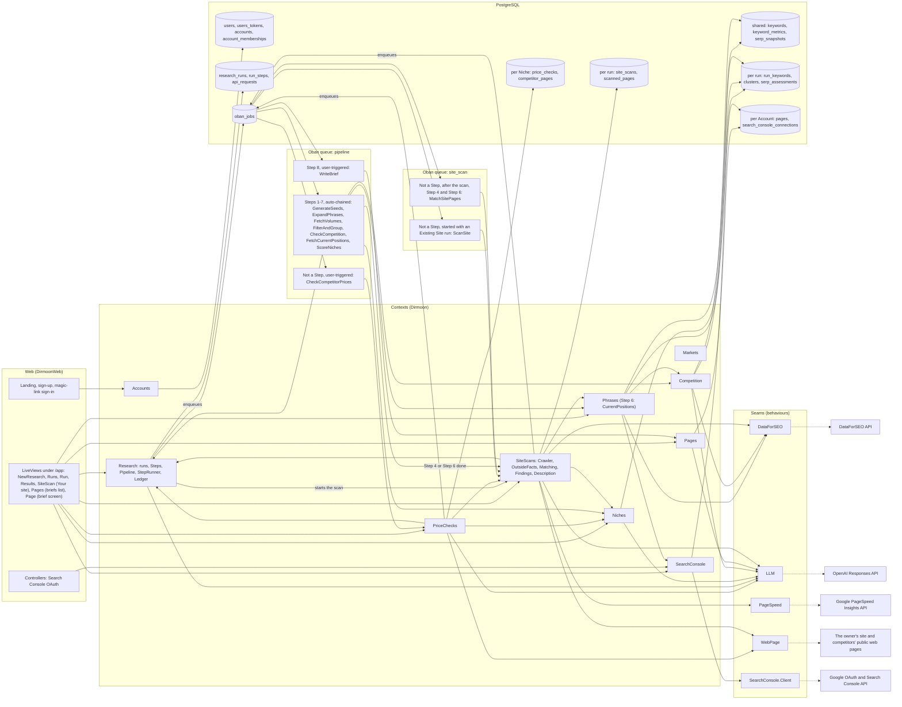

# Architecture

How dirmoon is built today. Planned work lives in `docs/design/README.md` (the product spec), `.claude/work/` plans and `docs/adr/`, not here. Terms in capitals are defined in `CONTEXT.md`.

## Overview

A signed-in User describes a business; a Research Run takes it through eight Steps, each an Oban job that calls one context and stores its output. Steps 1–7 run on their own and end with scored Niches. The User then picks a Niche (Step 8 writes its Brief: the plan and the text of one page, kept in a `Page` record) and edits the Brief, which they hand to whoever builds their site; dirmoon does not build, host or publish pages. LiveView screens follow a run over PubSub. An Existing Site run also gets a Site Scan, started with the run: on its own Oban queue (`site_scan`) it reads up to 50 of the site's own pages, stores their Page Facts and what outside services say about the site, then matches the pages to the run's Niches once both exist; the "Your site" screen works out the Findings from those stored facts when it is shown. On the results screen the User can also start a Price Check for a Niche: a background job reads the Niche's Competitor Pages and lists the prices they state. Neither the Site Scan nor a Price Check is a Step: neither can change the run's Steps or status. Five external services sit behind behaviours: an LLM, DataForSEO, Google Search Console (optional), Google PageSpeed Insights and the public web (reading a page).

## Stack

- Elixir ~> 1.17, Phoenix 1.8, Phoenix LiveView 1.2, Bandit
- Ecto with PostgreSQL (`Dirmoon.Repo`); the `citext` extension for `users.email`. The Repo's Postgrex JSON library is `Dirmoon.Repo.StrictJson` (set through `Dirmoon.Repo.PostgrexTypes`), which raises on a `Decimal` in any jsonb value; every jsonb write goes through `Dirmoon.JsonSafe.encode/1` first
- Oban (`Oban.Engines.Basic`, queues `pipeline` with 5 workers and `site_scan` with 2, `Oban.Plugins.Pruner`)
- Phoenix.PubSub (`Dirmoon.PubSub`) for run, page, Price Check and Site Scan updates
- Req for every HTTP client; Swoosh for email
- LazyHTML (a runtime dependency) parses every web page dirmoon reads, within limits (`Dirmoon.WebPage.HtmlDocument`); a `Task.Supervisor`, `Dirmoon.WebPage.ReadSupervisor`, runs each page read in its own process
- Tailwind v4 and esbuild; design tokens in `assets/css/tokens.css` (the handover tokens plus the app surface tokens `--app-*`/`--on-app*`), mapped to utilities in `assets/css/app.css`; fonts in `assets/css/fonts.css`; no daisyUI
- Gettext with the default locale `en` (no translations: Ecto error messages show in English); screen copy is English, written in the templates. Market-facing text (Seeds, Phrases and the Brief) is in the run's Market language (`run.language_name`, stored on the run when it starts and named in the LLM prompts)
- Tests: ExUnit, Mox, ExMachina, `Req.Test`, LazyHTML
- Styler, Credo (`--strict`) and ex_slop, all run by `mix precommit`, which also runs `mix test --cover` and fails below the line-coverage threshold in `mix.exs` (`test_coverage`; generated boilerplate and test support are ignored)

## Contexts

All under `lib/dirmoon/`. Functions that take an id from params take the `Scope` first and filter by `scope.account`; functions called from a Step take a `%Run{}` (or a struct) already resolved upstream.

| Context | Owns | Key public entry points | Calls |
|---|---|---|---|
| `Accounts` | `User` (`users`), `UserToken` (`users_tokens`), `Account` (`accounts`), `Membership` (`account_memberships`), `Scope`, `UserNotifier` | `sign_up/2`, `create_user_with_account/2`, `scope_for_user/1`, `login_user_by_magic_link/1`, `deliver_login_instructions/2`, session-token and email-change functions | `Mailer` |
| `Research` | `Run` (`research_runs`), `RunStep` (`run_steps`), `ApiRequest` (`api_requests`); `Steps`, `Pipeline`, `StepRunner`, `Ledger`, `Seeds` (Step 1), `StatusLine`, `RunsStatusLine` | `start_run/3` (Scope, attrs, `ledger_entries:`; starts the Site Scan of an Existing Site run in the same transaction), `get_run/2` (an id outside the database's id range is not found), `list_runs/1`, `stop_run/2`, `resume_run/2`, `run_cost/1`, `run_costs/1`, `estimated_cost/1` (`%{city?:, mode:}`), `running?/1`, `idle?/1`, `lock_run!/1`, `step_output/2`, `subscribe/1`, `broadcast_progress/2`, `broadcast_run_updated/1`; `Ledger.fetch/3`, `Ledger.record/2`; `Run.results_ready?/1`, `Run.choosable?/1`, `Run.normalised_domain/1` (the one rule that turns a typed address into the bare domain: parsed as a URL, only its host kept, lower-cased, a leading `www.` and a trailing dot dropped) | `Accounts` (Scope), `SiteScans` (`start/1`), `LLM` |
| `Phrases` | `Phrase` (`keywords`), `Metrics` (`keyword_metrics`), `RunPhrase` (`run_keywords`); `Expansion` (Step 2), `Volumes` (Step 3), `CurrentPositions` (Step 6), `LedgerRows` | `store_expansion/2`, `store_metrics/2`, `phrases_needing_metrics/2`, `list_for_run/2` (filters include `kept_or_ranked: true`), `count_by_status/1`, `top_kept_in_niches/2`, `top_kept_by_niche/2`, `market_totals_by_niche/1`, `clear_grouping/1`, `assign_to_niche/2`, `reject/2`, `reject_ungrouped/2`, `store_current_positions/2` (position and, when known, the ranking address), `quick_win_range/0`, `quick_win?/1` | `Research` (Ledger, `step_output/2`, `put_city_location/2`), `DataForSEO`, `SearchConsole` (`Positions.rows/1`, Step 6), `Competition` (`assessments_for_run/1`, Step 6) |
| `Niches` | `Niche` (`clusters`); `Grouping` (Step 4), `Scoring` (pure), `ScoreStep` (Step 7) | `store_grouping/2`, `list_for_run/1`, `list_summaries/1`, `niche_detail/2`, `niche_aggregates/1`, `store_scores/2`, `get_niche/2`, `choose/2`, `reject/2`; `Scoring.worth?/1`, `Niche.choosable?/1` | `Research` (Ledger, `lock_run!/1`, `idle?/1`, `Pipeline.start_step/2`), `Phrases`, `Competition`, `Pages`, `LLM` |
| `Competition` | `SerpSnapshot` (`serp_snapshots`), `SerpAssessment` (`serp_assessments`); `Check` (Step 5) | `fresh_snapshot/2`, `store_snapshot/1`, `store_assessment/2`, `assessments_for_run/1`, `assessment_summaries_for_run/1`, `verdict/1`, `holders/1`, `weak_share/1`, `direct_competitor_count/1`, `checked_line/2` | `Research` (Ledger, `running?/1`, `broadcast_progress/2`), `Phrases`, `DataForSEO`, `LLM` |
| `SearchConsole` | `Connection` (`search_console_connections`); `Client` (seam), `Positions` (one source of Step 6) | `authorize_url/2`, `connect/2`, `get_connection/1`, `connected?/1`, `disconnect/1`, `connection_for_run/1`, `refresh_token/1`; `Positions.rows/1` (the domain property's queries of the last 90 days, `{:unavailable, line}` when Search Console can't answer for the run) | `SearchConsole.Client` |
| `PriceChecks` | `PriceCheck` (`price_checks`), `CompetitorPage` (`competitor_pages`) with the embedded `CompetitorOffer`; `Checker` (the work of a Price Check) | `start/2`, `get_for_niche/1`, `competitor_pages/1`, `page_limit/0`, `subscribe/1`; worker-internal: `get_checking/1`, `record_page/3`, `record_linking_sites/2`, `finish/1`, `fail/2`; `CompetitorOffer.verified/2` | `Niches` (`get_niche/2`, `niche_detail/2`), `Research` (Ledger, `lock_run!/1`), `Phrases`, `SiteScans` (`LinkingSites.count/2`), `WebPage` (`fetch/1`, `text_page/1`, `PageFacts`), `LLM` |
| `SiteScans` | `SiteScan` (`site_scans`), `ScannedPage` (`scanned_pages`); `Crawler`, `Robots`, `Sitemap`, `OutsideFacts`, `LinkingSites`, `Matching`, `Description` (the draft on the new research screen), `Findings` with its rule modules (`Findable`, `PageContent`, `NicheCoverage`, `Visitor`, `Business`, and `SitePages`, which pages a rule looks at) and the `Finding` struct | `report/2` (the run, its scan and its Findings, for the "Your site" screen), `get_for_run/2`, `retry/2`, `stale?/1`, `subscribe/1`, `page_limit/0`; for a run already resolved: `status_of/1`, `matched_pages_by_niche/1`, `niche_comparison/2`; pipeline- and worker-internal: `start/1`, `enqueue_matching/1`, `get_scanning/1`, `get_for_matching/1`, `record_pages/2`, `put_facts/2`, `store_matches/2`, `finish/2`, `broadcast_updated/1`; `Description.draft/1`; `Findings.build/1`, `Findings.checks/0` | `Research` (`get_run/2`, Ledger, `Steps`), `Niches`, `Phrases`, `WebPage`, `DataForSEO`, `PageSpeed`, `LLM` |
| `Markets` | `Country` (`market_countries`), `Language` (`market_languages`): the Market lists, cached from DataForSEO | `countries/0`, `languages/0` (stored rows, fetched again on first need once older than `market_lists_max_age_days`; a failed or empty fetch keeps the stored rows; nothing stored and no answer is `{:error, reason}`), `find_market/1` (stored rows only, never the API), `default_market/0` (US, `en`) | `DataForSEO` |
| `Pages` | `Page` (`pages`) with the embedded `Brief`; `BriefWriter` (Step 8), `Placeholders`, `StatusLine` | `get_page/2`, `list_pages/1`, `change_brief/2`, `update_brief/3`, `subscribe/1`; pipeline-internal: `create_for_niche/2`, `restart_writing/1`, `writing_page_for_run/1`, `store_brief/2`, `fail_writing_pages/2` | `Research` (Ledger), `Phrases`, `LLM` |

Seam modules and helpers at the same level:

| Module | What it is |
|---|---|
| `Dirmoon.LLM`, `Dirmoon.DataForSEO`, `Dirmoon.SearchConsole.Client`, `Dirmoon.PageSpeed`, `Dirmoon.WebPage` | Behaviour plus dispatch to the adapter in app config (see External services) |
| `Dirmoon.WebPage.PublicUrl`, `Dirmoon.WebPage.WebAddress`, `Dirmoon.WebPage.HostName` | The address guard (only http/https, no `localhost` or loopback/private/link-local/shared/unspecified IP literal, at most 2,048 bytes), used by `WebPage.HTTP` on every address and redirect: `PublicUrl.check/1` first normalises the host to its ASCII form, then checks, and returns `{:ok, ascii_url}`, the address to request; and the pure rule for which addresses dirmoon reads and keeps (absolute http(s) with a host, at most 2,048 bytes), applied to every stored link, sitemap address, ranking address and redirect; and the one rule for international host names (`HostName`, pure): a host is kept, requested and compared in its ASCII form (`xn--…`, `to_ascii/1`, `canonical/1`, `bare/1`), which also maps full-width spellings to plain ASCII, and shown to the owner in Unicode (`to_unicode/1`). A run's `domain` is stored in ASCII form and shown with `HostName.to_unicode/1` |
| `Dirmoon.WebPage.HtmlDocument`, `Dirmoon.WebPage.VisibleText`, `Dirmoon.WebPage.PageFacts` | The HTML parser with limits (LazyHTML), HTML → visible text, and HTML → Page Facts (`from_html/2`; `comparison/1`, the few facts a site's page and a Competitor Page are compared on). Pure |
| `Dirmoon.Format` | English noun forms and number, decimal and money formatting (`plural/2`, `usd/1`, `money/2`, `integer/1`, `decimal/2`, `number_word/1`) |
| `Dirmoon.Spelling` | Compares spellings of Polish-market Phrases (`without_diacritics/1`, `diacritic_count/1`), used by Step 4 and the DataForSEO city match (which also strips any other combining accent, so a city in any country matches typed with or without its accents) |
| `Dirmoon.demo_services/0`, `Dirmoon.demo_data?/0` | The services answered by a `Demo` adapter right now (read from the adapter config keys), and whether there is any; the "TEST DATA" strip lists them |
| `Dirmoon.Workers.*` | The eight Step workers, `CheckCompetitorPrices`, `ScanSite` and `MatchSitePages` (see Background work) |

Schemas reference each other across contexts (`RunPhrase` belongs to a `Niche`, `Page` belongs to a `Niche` and a `Run`, the SERP schemas belong to a `Phrase`, `SiteScan` to a `Run` and `ScannedPage` to a `Niche`); queries on another context's table go through that context's functions.

## Web

`lib/dirmoon_web/router.ex`. Everything is server-rendered HTML; there is no JSON API.

| Scope | Pipelines | Serves |
|---|---|---|
| `/` | `:browser`, `:redirect_if_user_is_authenticated` | Landing page (`PageController.home/2`, `PageHTML`): the hero (with a line and link for owners who already have a site), the journey through one real research, "Already have a website?" (`#existing-site`: five plain lines on what the Site Scan tells an owner, with no figures, and what comes next) and the closing sign-up; `POST /sign-up` (`SignUpController.create/2`); a signed-in User is redirected to `/app` |
| `/users/log-in`, `/users/log-in/:token`, `POST /users/log-in`, `DELETE /users/log-out` | `:browser`; `live_session :current_user` | Magic-link sign-in: `UserLive.Login`, `UserLive.Confirmation`, `UserSessionController` |
| `/users/settings`, `/users/settings/confirm-email/:token` | `:browser`, `:require_authenticated_user`; `live_session :require_authenticated_user` | `UserLive.Settings` (change email) |
| `/app` | `:browser`, `:require_authenticated_user`; LiveViews in `live_session :app` | The signed-in app (tables below) |
| `/dev` (dev only) | `:browser` | LiveDashboard, Swoosh mailbox |

**Auth and the Scope.** `DirmoonWeb.UserAuth` is phx.gen.auth's magic-link flow: no passwords. `:browser` runs `fetch_current_scope_for_user`, which assigns `current_scope` (`%Accounts.Scope{user:, account:}`, the Account of the User's first Membership) from the session token or the remember-me cookie. `:require_authenticated_user` (plug) and `on_mount {UserAuth, :require_authenticated}` (LiveViews) redirect a guest to `/users/log-in`; `:redirect_if_user_is_authenticated` sends a signed-in User from the landing page and sign-up to `/app`. Sign-in lands on `/app`. Every context call from a screen or controller passes `current_scope`; a foreign or malformed id reads as "not found". Sign-up answers the same for a new email and one that already has a User.

Screens (all `Layouts.app`). The signed-in app is one full-screen dark shell in neutral graphite grays (the app surface tokens, not slate): chrome (top bar, sidebar, demo strip) on `--app-chrome`, the working area on `--app-bg`, cards, the status row and selected rows on `--app-raised`/`--app-selected`, inputs on `--app-field`; lime (`--accent`) is the one accent and `--warn` marks strong competition and errors. The `<body>` behind it is `--app-bg` (`on_mount {Layouts, :app_body}`); components shared with the light pages take `surface="app"` (`<.input>`, `<.prompt_box>`, the flash). The `--slate*` tokens remain for the landing page's dark panel and the produced page. The shell has a slim top bar (moon mark, `dirmoon / <context>`, the User's email, "Settings", "Log out"), a sidebar ("New research", "Results", "Pages"; a row of links under the top bar below 860px), the status row (the screen's first-person sentence and a note) and the screen's working area filling the rest. The "TEST DATA" strip sits above the top bar when Demo Data is on. No eyebrows, page-size headlines or marketing content in the app: the light dotted page, nav card, eyebrows and headlines belong to `Layouts.landing` (`/`) and `Layouts.auth` (sign-in) only. Settings (`/users/settings`) uses the app shell too.

| Route | Module | What it does |
|---|---|---|
| `GET /app` | `AppController.index/2` | Redirects to `/app/research/new` |
| `/app/research/new` | `NewResearchLive` | A tool view, no pitch: the run form (description, Mode, country and language from the Market lists, city, domain, Priority Services; the Market starts as the latest run's, US and English for a first run; with no list available it says why and disables the start button), example prompts, estimated API Cost (higher for Existing Site), the Search Console note (optional: what it adds, and the connect link), and the Account's five latest runs. In Existing Site mode the address comes first, with "Read my site": an async task drafts the description from the home page (`SiteScans.Description.draft/1`, in the Market's language). The draft fills an empty description, or one still equal to the previous draft; text the owner typed is never overwritten, and the draft is offered beside it ("Use this instead"). One draft runs at a time, at most five per screen. The draft's paid request is kept in the socket for the domain it was made for and passed to `Research.start_run/3` (`ledger_entries:`) only when the run starts for that same domain; the form's params never carry it |
| `/app/runs` | `RunsLive` | The newest 50 runs with status and API Cost; not live |
| `/app/runs/:id` | `RunLive` | Live Step list, Step 5 progress, stop and resume, API Cost; navigates to the results when Step 7 finishes. An Existing Site run also shows one line on where its Site Scan stands (`#run-site-scan`, `SiteScanAdvice.progress_line/2`) with a "Your site" link, updated from the scan's topic |
| `/app/runs/:id/results` | `ResultsLive` | Views `niches`, `phrases`, `rejected` (`?view=`, `?niche=`); Niche detail; choose and reject a Niche. Phrase views show at most 500 rows. An Existing Site run's views also lead to "Your site" (`#view-site`), and once the Site Scan's pages are matched to the Niches each topic in the list and the detail says "You have a page: <address>" or "No page yet" (`SiteScans.matched_pages_by_niche/1`; nothing while the matching isn't done). The Niche detail's "Competitor prices" section (`#competitor-prices`) starts a Price Check (`PriceChecks.start/2`), shows its progress, and lists each Competitor Page (domain linked to the address read, new tab, `noopener noreferrer`) with its offers as "name: price", "I found no prices on this page" or "This page could not be opened"; a failed check shows its reason and the button again; a Niche without direct competitors on page one says so instead. For an Existing Site run whose Price Check has read a page, the detail adds the page comparison (`DirmoonWeb.PageComparison`): the site's first matched page beside each Competitor Page, on words, headings, structured data, whether it states a price (known for Competitor Pages only), ways to contact and how many sites link to each site; an unknown figure shows as "—", and the site's row says why there is nothing to compare yet (no scan, still reading, site unreadable, not matched yet, no page for the topic) |
| `/app/runs/:id/site` | `SiteScanLive` | "Your site": the Site Scan's Findings under five plain questions (`SiteScanAdvice.question/1`), the topics question first ("Does your site cover what people search for?"), then whether Google can find and read the site, whether each page says what it is about, whether it works for a visitor on a phone and whether it looks like a real business to Google. Within a question, problems, then warnings, then checks not made, with the good ones folded under "What's fine"; each Finding says what it means and what to do (`SiteScanAdvice`) and lists the pages, topics or searches concerned. While scanning it shows pages read so far, live from the scan's topic (no Findings are worked out until the scan ends). A failed scan, or one stale for `site_scan_stale_after_minutes`, shows why and a button that runs it again (`SiteScans.retry/2`). A New Idea run says it has no site; another Account's run is not found |
| `/app/pages` | `PagesLive` | "Briefs": the newest 50 Pages, each one Niche's Brief |
| `/app/pages/:id` | `PageLive` | The brief screen: the Brief form (the page's text in the wide column; Phrases to cover and business details beside it), save, retry a failed Brief. No page preview or download |

Controllers in the `/app` scope, outside the live session:

| Route | Module | What it does |
|---|---|---|
| `GET /app/search-console/connect` | `SearchConsoleController.connect/2` | Puts a random `state` and a checked `return_to` (only `/app…` paths) in the session, redirects to Google |
| `GET /app/search-console/callback` | `SearchConsoleController.callback/2` | Accepts only the `state` issued to this session (single use), exchanges the code, stores the Connection |
| `DELETE /app/search-console` | `SearchConsoleController.delete/2` | Removes the Connection (does not revoke at Google) |

Shared web modules: `DirmoonWeb.UI` (buttons, wordmark, prompt box, "how it works" panel, stopped-run note), `RunDisplay` and `PageDisplay` (labels and paths), `ResultsHeadline`, `NicheAdvice` (the plain-language verdict on a Niche and its three reasons, from Score, market totals and pooled competition), `SiteScanAdvice` (every sentence the "Your site" screen says: per Finding check and level a title, what it means and what to do; the question headings, level labels and the scan's progress and status lines) and `PageComparison` (the Niche's "your page against theirs" table).

## Background work

Two Oban queues: `pipeline` (5 workers) for the Steps and Price Checks, and `site_scan` (2 workers) for the Site Scan and the matching of its pages, so a slow site never holds up a Step. Each Step worker is `use Oban.Worker, queue: :pipeline, max_attempts: 3` with args `%{run_id: id}` and a `perform/1` that hands the Step's function to `Research.StepRunner.run/3`. `Research.Steps` is the one list of Steps (number, key, name, worker, Modes).

| Step | Worker | Triggered by | Calls | Writes |
|---|---|---|---|---|
| 1 Seeds | `GenerateSeeds` | `Research.start_run/2` | `Research.Seeds.generate/1` (LLM) | Step output: 10–20 Seeds and customer questions |
| 2 Expansion | `ExpandPhrases` | Step 1 done | `Phrases.Expansion.expand/1` (DataForSEO phrase ideas, 20 Seeds per request) | `keywords`, `keyword_metrics` (country), `run_keywords` |
| 3 Volumes | `FetchVolumes` | Step 2 done | `Phrases.Volumes.fetch/1` (DataForSEO location lookup and search volumes, 1000 Phrases per request) | `research_runs.city_location_code`, `keyword_metrics` for the country and the city, only for Phrases with no Volume fetched in the last 30 days |
| 4 Filter and Group | `FilterAndGroup` | Step 3 done | `Niches.Grouping.group/1` (LLM; the 400 highest-Volume Phrases) | Replaces the run's `clusters`; sets `run_keywords.status`, `rejection_reason`, `cluster_id` |
| 5 Competition | `CheckCompetition` | Step 4 done | `Competition.Check.check/1` (DataForSEO SERP, asked for the run's city when it has one, else the country, and LLM labels for the 30 highest-Volume kept Phrases in Niches) | `serp_snapshots` (or reuses one under 30 days old), `serp_assessments`; broadcasts progress per Phrase |
| 6 Current Positions | `FetchCurrentPositions` | Step 5 done; Existing Site only (the pipeline marks it skipped for New Idea) | `Phrases.CurrentPositions.fetch/1`: Search Console (`SearchConsole.Positions.rows/1`, last 90 days, up to 5000 queries) when the Account's Connection can read the domain and has queries for it; otherwise DataForSEO's ranked phrases for the domain in the run's country (up to `ranked_phrases_limit`, via the ledger) plus the run's own SERP Snapshots for the Phrases those did not place. A result counts as the site when its host is the domain or `www.` and the domain. When DataForSEO can't give ranked phrases (it refuses the task, or Demo Data) the Step goes on with the first pages only and keeps the reason in its output. It no longer skips without a Connection. When it ends it enqueues the matching of the Site Scan's pages (`SiteScans.enqueue_matching/1`, which never raises) | `run_keywords.current_position` and `current_position_url`; Step output `sources`, `matched`, `quick_wins` and why a source was not used |
| 7 Scoring | `ScoreNiches` | Step 6 done or skipped | `Niches.ScoreStep.score/1` (no external call) | `clusters.score`, `score_components`; the run becomes `awaiting_choice` |
| 8 Brief | `WriteBrief` | The User: `Niches.choose/2` | `Pages.BriefWriter.write/1` (LLM) | The run's `writing` page: `pages.brief`, status `ready`; on final failure `failed` |

**Price Checks** run outside the Steps. `CheckCompetitorPrices` (queue `pipeline`, `max_attempts: 3`, args `%{price_check_id: id}`, unique per args while incomplete) is enqueued by `PriceChecks.start/2`, which locks the run, needs `Run.results_ready?/1` and picks the Competitor Pages from the Niche's first pages: results labelled direct competitor with an http(s) address, one per domain at its best position, at most `price_check_page_limit` (5). One check per Niche (unique `cluster_id`); asking again while it is `checking` or `done` returns it; a `failed` one runs again for the pages still `waiting`. `PriceChecks.Checker.check/1` first, for an Existing Site run only, asks once how many other sites link to each Competitor Page's domain (`SiteScans.LinkingSites.count/2`, one DataForSEO request via the ledger; a refusal, error or crash leaves the counts nil and never fails the check). It then reads each waiting page once, raw, through `WebPage.fetch/1` via the ledger (service `web_page`, operation `fetch_text`, cost 0); the ledger keeps the visible text and address read (`WebPage.text_page/1`) and, for an HTML page, the comparison facts (`PageFacts.comparison/1`, stored on the Competitor Page), never the HTML. Then one LLM request (`:competitor_prices`, via the ledger; an answer without an `offers` list is rejected and not stored), then `CompetitorOffer.verified/2` keeps only offers whose quote occurs in the page text and whose price occurs in the quote (whitespace collapsed). Each page's outcome is stored as soon as it is known: `prices_found`, `no_prices` (also a page with no visible text, which is not sent to the LLM) or `unreadable` (a fetch error; the check goes on). An LLM error is retried; on the last attempt, at once for `:llm_not_configured`, or after a crash, the check becomes `failed` with `StepRunner.readable_reason/1` and the job is cancelled. It never touches the run's Steps or status. Topic `price_checks:<run_id>` carries `{:price_check_updated, niche_id}`; `ResultsLive` subscribes to it.

**The Site Scan** runs outside the Steps too. `Research.start_run/3` stores an Existing Site run's `SiteScan` as `scanning` and enqueues `ScanSite` (queue `site_scan`, `max_attempts: 3`, args `%{site_scan_id: id}`, unique per args while incomplete) in the run's transaction; a New Idea run has none. `SiteScans.Crawler.crawl/1`, in order:

1. Tries `https://` and `http://`, each on the bare and the `www.` host; the home page is where the first variant answering 200 ends up. None answering 200 is the scan's error.
2. Reads robots.txt for every crawler (`User-agent: *`, `SiteScans.Robots`): a 4xx means no file and everything allowed, a 5xx or no answer is noted as unreadable and everything allowed. Its rules are kept in memory, not stored, and read again on each try.
3. Reads the sitemaps robots.txt names, else `/sitemap.xml`, nested sitemap indexes included, at most five documents (`SiteScans.Sitemap`).
4. Walks the site's own host (a leading `www.` ignored) breadth-first from the home page's links, then the sitemap's pages, four pages at a time, up to `site_scan_page_limit` (50) Scanned Pages. robots.txt is applied once per address just before it is read; a disallowed address is noted as blocked and never requested. A page whose read ends on another host is stored without Page Facts. At most twice the page limit of linked addresses are queued.
5. Link check: of the internal links found but not read (the first 200), up to 100 that robots.txt allows are requested and the broken ones noted.
6. What others say (`SiteScans.OutsideFacts`): the home page's phone speed (`PageSpeed`), Google's rough indexed page count, the Google Business Profile for the business name the pages' structured data gives (not looked up without one) in the run's city, else its country, and how many other sites link to the domain. Each goes through the ledger and none can fail the scan: a request that can't be answered is stored as `%{"checked" => false, "reason" => …}`.

Each batch of pages is stored as soon as it is read (`record_pages/2`), so a retried crawl never reads a stored page again; site-level facts go on the scan (`put_facts/2`), and every write bumps the scan's `updated_at`. An error or crash is retried by Oban; on the last attempt the scan becomes `failed` with `StepRunner.readable_reason/1`. The run's Steps and status are never touched. `SiteScans.retry/2` (the screen's button) runs a `failed` scan again, or one still `scanning` that has stored nothing for `site_scan_stale_after_minutes` (15; its job was lost, say to a restart); the pages already read are kept. Topic `site_scans:<run_id>` carries `{:site_scan_updated, run_id}`; `RunLive`, `ResultsLive` and `SiteScanLive` subscribe to it.

**Matching** pages to Niches is one `MatchSitePages` job per run (queue `site_scan`, args `%{run_id: id}`, unique per run in every incomplete state, running included), enqueued by `SiteScans.enqueue_matching/1` when the scan ends, when Step 4 ends and when Step 6 ends, whichever comes first; a second trigger adds nothing. A job that finds a side not ready (`Matching.readiness/1`: the scan not `done`, or Step 4 not done) snoozes 20 s and looks again (a snooze doesn't use up an attempt); it gives up, storing nothing, when the pages can never be matched (the scan failed, or the run stopped or failed before Step 4), and stores `"not_ready"` after waiting 30 minutes. `SiteScans.Matching.match/1` sends the LLM (`:match_pages`, via the ledger, at most 50 pages per request) the run's Niches that are not rejected, each with up to five top Phrases, and the site's own readable pages (`Findings.SitePages.own_pages/1`: canonical variants left out) by index number, with address path, title and first main heading, as JSON data cut short. A pair whose page index or Niche id was not sent is dropped, and each page keeps its first valid answer, so the model can only pair the run's own pages with the run's own Niches. No transaction is held across the LLM request: the answer is stored in the ledger first, then the matches (`scanned_pages.cluster_id`) and the outcome (the scan's `"matching"` fact) in one transaction. With Demo Data or no LLM the matching is stored as not done with that reason.

**Findings are derived, never stored.** `SiteScans.report/2` loads a finished scan with its pages and calls `Findings.build/1` with the run's Niche summaries, its kept Phrases (plus any the site ranks with) and the page limit. Each rule module answers one question with `%Finding{question, check, level, pages, page_count, figures}`, levels `problem`, `warning`, `not_checked`, `good`; `Findings.checks/0` lists every check and level the rules can give, and `SiteScanAdvice` has copy for each. A fact not stored yet, or of an unexpected type, gives no Finding, so the rules never raise. Findings say only what was measured: for example `:tappable_contact` checks for `tel:`/`mailto:` links, not for phone numbers written as text. Changing a check or its wording needs no migration and no rescan.

Pipeline rules:

- **`StepRunner.run/3`** runs a Step only while the run is `running`, and never a finished Step twice. The Step function returns `{:ok, %{result:, output:}}`, `{:skip, line}`, `{:error, reason}` or `:stopped`. It marks the Step, broadcasts `{:run_updated, id}` and calls `Pipeline.advance/1`. An error is retried by Oban; on the last attempt, or at once for a `*_not_configured` reason, the Step and the run become `failed` with a readable reason (`StepRunner.readable_reason/1`) and the job is cancelled.
- **`Pipeline.advance/1`** enqueues the next waiting Step of 1–7, skipping one that does not apply to the Mode. With Steps 1–7 finished it enqueues a `queued` Step 8, or, with no Step queued or running, settles the run as `awaiting_choice` (also after Step 8 has written a Brief). One Step job per run at a time; jobs are unique per worker and args.
- **Step statuses:** `waiting`, `queued`, `running`, `done`, `skipped`, `failed`. `queued` is only for Step 8: from the User's request until the job starts, and again when interrupted, so a resume knows to run it.
- **Run statuses:** `running`, `stopped`, `failed`, `awaiting_choice`. There is no finished status: a run whose Steps 1–7 are done waits for another Niche choice. "Results are ready" is not a status: it is Step 7 being `done` (`Run.results_ready?/1`).
- **Stop** (`Research.stop_run/2`) sets the run `stopped` and cancels its jobs that have not started. A Step at work finishes its current call; Step 5 checks `Research.running?/1` between Phrases and returns `:stopped`, which puts the Step back without an error.
- **Resume** (`Research.resume_run/2` → `Pipeline.resume/1`) works for a `stopped` or `failed` run: failed and interrupted Steps 1–7 wait again and the first unfinished one is enqueued; an interrupted or queued Step 8 is enqueued again; a Step 8 that failed is not retried (the User chooses the Niche again). Done and skipped Steps are never rerun.
- **Run lock:** `stop_run/2`, `resume_run/2` and `Niches.choose/2` each lock the run row first (`Research.lock_run!/1`) inside their transaction. Starting Step 8 requires `Research.idle?/1`: the run is not `running` and no Step is `queued` or `running`.
- **API ledger:** every paid call goes through `Research.Ledger.fetch/3`, which stores request, response and cost in `api_requests`, unique per run by a hash of service, operation and request. A request the run already stored is replayed from the table, so retries and resumes never pay twice. LLM answers are validated inside the ledger function, so a rejected answer is not stored. A run's API Cost is the sum of its rows. Also through it: a Price Check's page reads and the Site Scan's PageSpeed check, at cost 0 (the PageSpeed answer is stored cut down to the figures it is read from, without screenshots); the Site Scan's indexed page count, Business Profile and linking sites, Step 6's ranked phrases and the matching's LLM requests, at the cost DataForSEO or OpenAI reports. When DataForSEO answers but refuses the task itself (ranked phrases, Business Profile, linking sites: a location it doesn't cover, no access to link data), that "unavailable" answer is stored with its raw body and reported cost, so it is not asked and paid again; the caller carries on without it and never fails the run or the scan. A failure without an answer is stored nowhere and asked again on the next try. The description drafted on the new research screen is paid before the run exists: `Research.start_run/3` records it on the new run with `Ledger.record/2`, so it counts in the run's API Cost. Not in the ledger: Search Console queries (free) and the Site Scan's reads of the site's own pages (free; only their Page Facts are kept).
- **Live updates:** topic `run:<id>` carries `{:run_updated, id}` and `{:run_progress, id, map}`; topic `page:<id>` carries `{:page_updated, id}`; `price_checks:<run_id>` and `site_scans:<run_id>` as above.

## Data

Migrations in `priv/repo/migrations/`. Table names keep the handover's words (`keywords`, `clusters`); the code calls them Phrases and Niches. No table prefixes, no views. Sharing follows ADR-0002.

| Table | Schema (owner) | Scope | Notable columns, constraints and indexes |
|---|---|---|---|
| `users` | `Accounts.User` | global | `email` citext, unique |
| `users_tokens` | `Accounts.UserToken` | per User | unique (`context`, `token`) |
| `accounts` | `Accounts.Account` | the tenant | timestamps only |
| `account_memberships` | `Accounts.Membership` | User ↔ Account | no primary key; unique (`account_id`, `user_id`) |
| `research_runs` | `Research.Run` | per Account | Market: `country_code`, `location_code`, `country_name`, `language_code`, `language_name` (names copied from the Market lists at start; rows from before were backfilled for US, GB, PL, en and pl, else the bare code); index (`account_id`, `inserted_at`); checks: at most five `priority_services`, `domain` required for `existing_site` |
| `run_steps` | `Research.RunStep` | per run | unique (`run_id`, `number`); check `number` 1–8; `output` jsonb is how a later Step reads an earlier one (`Research.step_output/2`) |
| `api_requests` | `Research.ApiRequest` | per run | unique (`run_id`, `request_hash`); `cost` decimal(12,6), check `cost >= 0`; insert-only |
| `keywords` | `Phrases.Phrase` | **shared** | unique (`phrase`, `language_code`); `phrase` normalised (trimmed, lower case, single spaces) |
| `keyword_metrics` | `Phrases.Metrics` | **shared** | unique (`keyword_id`, `location_code`); volume, CPC, currency, `monthly_searches` jsonb (the `trend` field), `fetched_at`; an upsert replaces a row only with a newer `fetched_at` |
| `serp_snapshots` | `Competition.SerpSnapshot` | **shared** | unique (`keyword_id`, `location_code`, `fetched_at`); append-only; `results` jsonb (position, URL, domain, title) |
| `run_keywords` | `Phrases.RunPhrase` | per run | unique (`run_id`, `keyword_id`); `status` (`kept`/`rejected`), `rejection_reason`, `cluster_id` (nilified with the Niche), `current_position`, `current_position_url` (the address that ranks, when the source gives one: DataForSEO or a SERP Snapshot, not Search Console); `keyword_id` on delete restrict |
| `clusters` | `Niches.Niche` | per run | unique (`run_id`, `position`); `score` decimal(4,2), `score_components`, `status` (`proposed`/`rejected`/`chosen`) |
| `serp_assessments` | `Competition.SerpAssessment` | per run | unique (`run_id`, `keyword_id`); `labels` jsonb (position, Page Type), `verdict`, `reused_snapshot` |
| `pages` | `Pages.Page` | per Account | unique `cluster_id` (one page per Niche, deleted with it); `brief` jsonb (embedded `Brief`; keys of Briefs written before the page build was removed, such as `fact_tiles` or `cta_label`, are ignored on load and dropped on the next save); `status` `writing`/`ready`/`failed`; partial unique index on `run_id` where `status = 'writing'` (one Brief written per run at a time) |
| `price_checks` | `PriceChecks.PriceCheck` | per Niche | unique `cluster_id` (one check per Niche, deleted with it or the run); `status` `checking`/`done`/`failed`, `error` |
| `competitor_pages` | `PriceChecks.CompetitorPage` | per Price Check | unique (`price_check_id`, `domain`); `google_position`, `url`, `read_url` (after redirects), `outcome` `waiting`/`prices_found`/`no_prices`/`unreadable`, `offers` jsonb (embedded `CompetitorOffer`: name, price as written, quote), `facts` jsonb (the comparison subset of the page's Page Facts, `PageFacts.comparison/1`: a few hundred bytes; nil when unread, not HTML or read before it was kept), `linking_sites` integer (check `>= 0`; nil when unknown) |
| `site_scans` | `SiteScans.SiteScan` | per run | unique `run_id` (one scan per run, deleted with it); `status` `scanning`/`done`/`failed`, `error`, `pages_read`, `facts` jsonb: the site-level facts (address variants, https, robots.txt summary, sitemap, blocked pages, links checked and broken links, speed, indexed pages, Business Profile, linking sites, matching outcome), each list capped so the whole map stays under 300 KB |
| `scanned_pages` | `SiteScans.ScannedPage` | per Site Scan | unique (`site_scan_id`, `url`); `position` (read order), `http_status` (nil when no answer), `facts` jsonb (the Page Facts plus final address, redirects and content type, or `read_error`, or `off_site`; under 175 KB), `cluster_id` (the matched Niche, nilified with it; indexed) |
| `search_console_connections` | `SearchConsole.Connection` | per Account | unique `account_id`; `encrypted_refresh_token` (`Plug.Crypto`, keyed by the endpoint's `secret_key_base`) |
| `market_countries` | `Markets.Country` | **shared** | no primary key; unique `country_code` (the upsert target); `location_code`, `name`, `fetched_at`. The whole list is replaced on refresh |
| `market_languages` | `Markets.Language` | **shared** | no primary key; unique `language_code` (the upsert target); `name`, `fetched_at`. The whole list is replaced on refresh |
| `oban_jobs` | Oban | — | Oban's own migration |

The shared tables hold nothing that identifies an Account: no description, domain, run id or Search Console figure. Everything a run decided (kept or rejected, Niche, Page Type labels, Current Position and its address) is in the per-run tables, and so is everything about the owner's site: the Site Scan, its Scanned Pages and the Page Facts of Competitor Pages are per run, never reused by another run or Account (ADR-0002 shares only market data). Raw HTML is never stored, only Page Facts. Deleting an Account or a run cascades to its rows; shared rows stay.

## External services

Each service is a behaviour with a dispatching module; the adapter is one app-config key. `config/config.exs` sets every adapter to `NotConfigured`, `config/dev.exs` the LLM and DataForSEO ones to `Demo` (Search Console and PageSpeed have no `Demo` adapter and stay `NotConfigured` in dev, so no Current Position or speed is made up), `config/test.exs` to a Mox mock. `config/runtime.exs` switches to the real adapter outside test when the environment variables are set (in dev too).

| Seam (behaviour) | Config key | Real adapter | Selected when | Demo / NotConfigured | Tests |
|---|---|---|---|---|---|
| `Dirmoon.LLM` (`structured/1`) | `:llm_adapter` | `LLM.OpenAI` | `OPENAI_API_KEY` (model: `OPENAI_MODEL`, default `gpt-6.2-sol`) | `LLM.Demo` / `LLM.NotConfigured` (`:llm_not_configured`) | `Dirmoon.LLMMock`; `OpenAI` itself against `Req.Test` |
| `Dirmoon.DataForSEO` (`phrase_ideas/1`, `search_volumes/1`, `serp_top10/1`, `ranked_phrases/1`, `indexed_page_count/1`, `business_profile/1`, `linking_sites/1`, `find_location/1`, `countries/0`, `languages/0`; the last two read the free `GET /v3/keywords_data/google_ads/locations` (rows of `location_type` Country) and `GET /v3/keywords_data/google_ads/languages`) | `:data_for_seo_adapter` | `DataForSEO.HTTP` | `DATAFORSEO_LOGIN` and `DATAFORSEO_PASSWORD` | `DataForSEO.Demo` / `DataForSEO.NotConfigured` (`:data_for_seo_not_configured`) | `Dirmoon.DataForSEOMock`; `HTTP` itself against `Req.Test` |
| `Dirmoon.SearchConsole.Client` (`authorize_url/1`, `exchange_code/1`, `refresh_access_token/1`, `query/1`) | `:search_console_adapter` | `SearchConsole.Client.Google` | `GOOGLE_CLIENT_ID` and `GOOGLE_CLIENT_SECRET` | no Demo / `Client.NotConfigured` (`:search_console_not_configured`) | `Dirmoon.SearchConsoleMock`; `Google` itself against `Req.Test` |
| `Dirmoon.PageSpeed` (`check/1`) | `:page_speed_adapter` | `PageSpeed.HTTP` (`GET /pagespeedonline/v5/runPagespeed`, `strategy=mobile`, performance and accessibility categories) | `PAGESPEED_API_KEY` (dirmoon's own key) | no Demo / `PageSpeed.NotConfigured` (`:page_speed_not_configured`) | `Dirmoon.PageSpeedMock`; `HTTP` itself against `Req.Test` |
| `Dirmoon.WebPage` (`fetch/1`, `fetch_text/1`; `text_page/1` and `html?/1` are pure helpers) | `:web_page_adapter` | `WebPage.HTTP` | Always outside test (no credentials; set in `config/config.exs`) | none | `Dirmoon.WebPageMock`; `HTTP` itself against `Req.Test` |

- **The LLM is OpenAI.** `LLM.OpenAI` sends one Responses API request per structured request, with the Step's schema as a strict JSON schema (every object closed with `additionalProperties: false`) and `store: false`. The cost is the reported token usage times the prices in `config :dirmoon, Dirmoon.LLM.OpenAI` (`prices`, USD per million tokens, cached input priced apart); a model without prices is refused before any request. A refusal, a cut-short answer or text that is not a JSON object is an error. With `NotConfigured` Step 1 fails at once with "No OpenAI API key".
- **The OpenAI, DataForSEO, Google Search Console and PageSpeed adapters have never been run against the live services.** They were written from the documentation and are tested only against `Req.Test` stubs; their assumptions are listed in `docs/MEMORY.md` and, for the Site Scan's requests, in the plan's API notes. The new DataForSEO operations: `ranked_phrases/1` is Labs' `ranked_keywords/live` (countries only, so it is sent the run's country code, never a city's); `indexed_page_count/1` is an organic SERP request for `site:<domain>`, reading Google's result count; `business_profile/1` is Business Data's `my_business_info/live`; `linking_sites/1` is Backlinks' `bulk_referring_domains/live`, up to 20 domains in one request.
- **Reading a web page.** `WebPage.HTTP` sends one GET with a generic User-Agent (`Mozilla/5.0 (compatible; PageReader/1.0)`, nothing identifying the app or the owner), 5 s connect and 10 s receive timeouts (the receive timeout per chunk), no compression, and follows redirects by hand so every address passes `PublicUrl.check/1` and is requested at the address it returns (an international host in its ASCII form): at most five for `fetch/1` (the Site Scan reports redirect chains), three for `fetch_text/1`. Host names are not resolved, so a public name pointing at a private address is not caught. On top of the timeouts one read, redirects included, has a 20 s deadline (`read_deadline`), so a server that drips its answer can't hold a scan: the read runs in its own process under `Dirmoon.WebPage.ReadSupervisor`, the caller kills it shortly after the deadline, and a watcher kills it when its caller dies, so a killed Site Scan leaves no read behind. `fetch/1` reads the body of HTML, XHTML, plain text and XML answers (any other type answers an empty body), at most 2 MB (the rest is not downloaded), and answers any status; `fetch_text/1` takes only a 200 HTML or plain-text answer and cuts its visible text to 15 000 characters. HTML is parsed by LazyHTML (`HtmlDocument`) within limits on nesting depth (512), attributes per tag (200), memory and time (5 s); a page past a limit reads as an empty document. Page Facts are bounded whatever the page (texts cut, at most 100 internal and 50 external links, 50 main and 50 sub-headings, 50 phones and 50 e-mails; under 160 KB in all). `LLM.Demo` answers `:competitor_prices` with no offers, so Demo Data never shows a price.
- Demo adapters return deterministic, obviously synthetic data (text marked `(demo)`, never a Placeholder; `*.example` domains) at cost 0. `DataForSEO.Demo`'s Market lists are a short real list instead: the United States, the United Kingdom and Poland; English and Polish. Anything that would read as a fact about the owner's real site or business has no demo answer and returns `{:error, :not_in_demo_data}`: DataForSEO's ranked phrases, indexed page count, Business Profile and linking sites, and the LLM's `:match_pages` and `:describe_site`. The Site Scan and Step 6 record these as not checked (reason `not_in_demo_data`) and go on.
- A `NotConfigured` LLM or DataForSEO fails the Step immediately, without retries. A `NotConfigured` Search Console is one unavailable source: Step 6 goes on with DataForSEO. A `NotConfigured` PageSpeed, DataForSEO or LLM never fails the Site Scan: its fact or the matching is stored as not checked with the reason `not_configured`.
- The mocks are defined in `test/test_helper.exs`. Real adapters set `retry: false` and take `req_options` from config, which is where test config plugs `Req.Test`.
- Email: `Dirmoon.Mailer` (Swoosh). `Swoosh.Adapters.Local` in dev (mailbox at `/dev/mailbox`), `Swoosh.Adapters.Test` in test. No production adapter is configured.

Other runtime settings in `config/config.exs`: `grouping_phrase_limit` (400), `serp_phrase_limit` (30), `serp_max_age_days` (30), `market_lists_max_age_days` (30, how old the Market lists may get before they are fetched again), `scoring_weights` (volume 0.4, CPC 0.3, weakness 0.3), `price_check_page_limit` (5), `site_scan_page_limit` (50, the most Scanned Pages one scan reads), `site_scan_stale_after_minutes` (15, how long a `scanning` scan may store nothing before the User may run it again), `ranked_phrases_limit` (1000, the most ranked phrases Step 6 buys), `cost_estimates` (the per-request prices behind the estimate on the new research screen, marked unverified in the config: `phrase_ideas`, `search_volumes`, `serp_top10`, `llm_allowance`, and for an Existing Site run `ranked_phrases_request` plus `ranked_phrases_per_phrase` × `ranked_phrases_limit`, `indexed_page_count`, `business_profile`, `linking_sites_request` plus `linking_sites_per_domain`; PageSpeed and Search Console are free, and a Price Check, started on demand, is not in the estimate). `Dirmoon.WebPage.HTTP` takes `read_deadline` (ms) and `Dirmoon.PageSpeed.HTTP` `api_key`, `base_url` and `req_options`.

Known limits of the Site Scan and Step 6, accepted for now:

- DataForSEO's ranked phrases are country-level: a city run's Current Positions from DataForSEO are the country's, and only the run's own SERP Snapshots are per city.
- PageSpeed's real-visitor (field) figures exist only for pages and sites with enough Chrome traffic, so a small site usually gets Google's test-load figures only, and interaction speed not at all.
- `PublicUrl` checks the address, not where its host name resolves: a public name pointing at a private address is read.
- "Read my site" is limited to five drafts per screen, not per Account or per day: reloading the screen starts again.
- A scan whose job is lost shows as reading until `site_scan_stale_after_minutes` have passed without a write; only then can the owner restart it.
- A drafted description that never becomes a run is paid for but recorded nowhere.

## Decisions

- [ADR-0001](docs/adr/0001-accounts-with-open-sign-up.md): Accounts with open sign-up, tenancy through Memberships, the Scope. Shapes `Accounts`, `UserAuth` and every Scope-first context function.
- [ADR-0002](docs/adr/0002-market-data-is-shared-across-accounts.md): market data shared across Accounts. Shapes the shared and per-run tables in `Phrases` and `Competition`, and what counts toward API Cost.
- Smaller decisions and accepted limitations: `docs/MEMORY.md`.

## Layout

| Path | What goes there |
|---|---|
| `lib/dirmoon/` | Contexts (`Dirmoon.*`): one module per context plus a folder with its schemas and Step modules; the seam behaviours and their adapters |
| `lib/dirmoon/workers/` | The eight Oban workers, one per Step, `CheckCompetitorPrices`, and the Site Scan's `ScanSite` and `MatchSitePages` |
| `lib/dirmoon_web/` | Web layer (`DirmoonWeb.*`): router, `user_auth.ex`, display helpers |
| `lib/dirmoon_web/live/` | LiveViews (`*_live.ex`, `user_live/`) |
| `lib/dirmoon_web/controllers/` | Controllers and the landing page's HEEx |
| `lib/dirmoon_web/components/` | `ui.ex` (design-system components), `core_components.ex`, `layouts.ex` |
| `assets/css/` | `app.css`, `tokens.css`, `fonts.css` |
| `config/` | `config.exs` (defaults, limits, weights), `dev.exs` (Demo adapters for the LLM and DataForSEO), `test.exs` (mocks), `runtime.exs` (credentials → real adapters) |
| `priv/repo/migrations/` | Migrations (generate with `mix ecto.gen.migration`) |
| `test/dirmoon/` | Context, Step and adapter tests, mirroring `lib/dirmoon/`; worker tests in `workers/` |
| `test/dirmoon_web/` | `controllers/<controller>/<action>_test.exs`, `live/<live_view>_test.exs`, `components/` |
| `test/support/` | `ConnCase`, `DataCase`, `factory.ex` (ExMachina), `accounts_helpers.ex` |
| `docs/design/` | Design handover: product spec (`README.md`), `tokens.css`, reference HTML and screenshots in `reference/` |
| `docs/adr/`, `docs/MEMORY.md` | ADRs and the decision log |

## Where new code goes

- A new domain area gets its own context module under `lib/dirmoon/`, owning its schemas and tables. Per-Account functions take the `Scope` first; `account_id` is never cast from params.
- A new or changed Step: its logic is a function `(%Run{}) -> {:ok, %{result:, output:}} | {:skip, line} | {:error, reason} | :stopped` in the owning context, its worker a one-line `StepRunner.run/3` call in `lib/dirmoon/workers/`, and its entry in `Research.Steps`. Read an earlier Step's output with `Research.step_output/2`.
- Every paid external call goes through `Research.Ledger.fetch/3`, with validation of the answer inside the ledger function.
- A new external service gets a behaviour module with dispatch, `Demo` (unless made-up data would mislead, as for Search Console and PageSpeed; an operation that would describe the owner's real site or business answers `{:error, :not_in_demo_data}` in a `Demo` adapter) and `NotConfigured` adapters, a real adapter on Req that reads `req_options` from config, a Mox mock in `test/test_helper.exs`, and its switch in `config/runtime.exs`.
- Market data that is the same for every Account goes in a shared table and must not identify an Account (ADR-0002); anything a run decided goes in a per-run table.
- Screens are LiveViews in `live_session :app` under `/app`, inside `Layouts.app` (pass `context`, `active`, the `:status` sentence and a `note`), built from `DirmoonWeb.UI` and the app surface tokens (never a `slate` utility; `ui_test.exs` checks). Their columns fill the shell's working area; no hero, eyebrow or page-size headline. The Search Console OAuth redirects are controllers in the same scope, outside the live session.
- Work that must not fail a run (like the Site Scan or a Price Check) is not a Step: its own record and status, its own worker, and it never touches the run's Steps or status.
- Every address the app reads goes through the web page seam (`WebPage.fetch/1` or `fetch_text/1`), so it passes `PublicUrl.check/1`; nothing calls Req on an address from a page or a User directly.
- Interface copy is English. Noun forms and number formatting go through `Dirmoon.Format`; labels shared by screens go in `RunDisplay` or `PageDisplay`. A prompt names what the model writes for the owner (English) and what it writes for the market (the run's market language).
